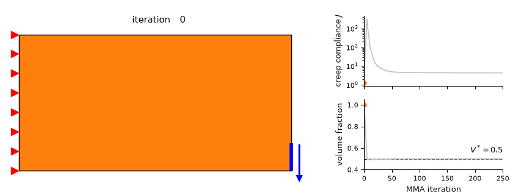
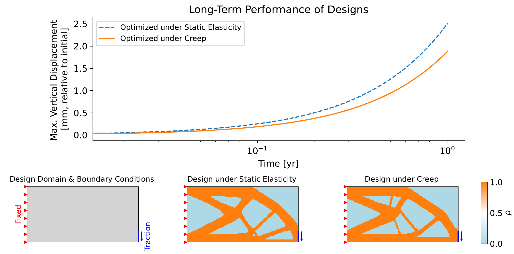
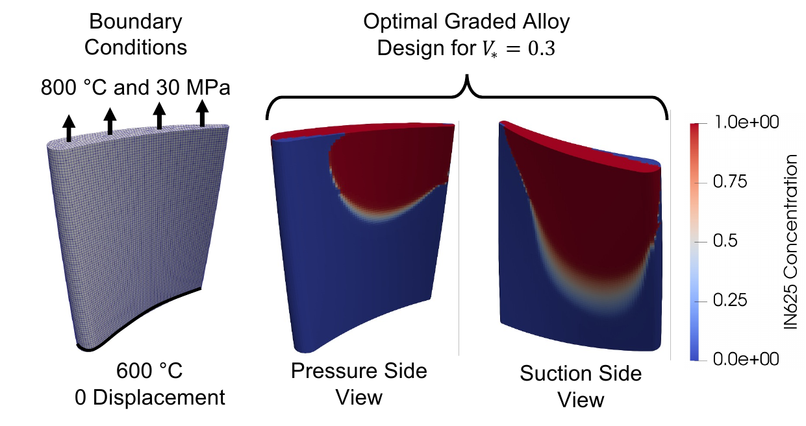
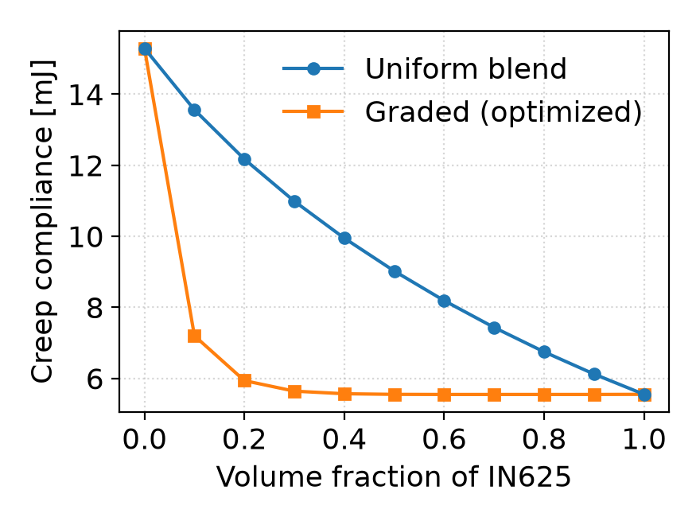

# Thermo-Structural Topology Optimization Considering Nonlinear Creep

[](https://github.com/Stefan-Knapik/creep-topopt/actions/workflows/tests.yml)
[](https://arxiv.org/abs/2607.22833)
[](LICENSE)


Code for

> S. Knapik, A. Chandrasekhar, D. Sharma, J. Cao, C. Sun, W. Chen.
> **Thermo-Structural Topology Optimization Considering Nonlinear Creep.**
> Submitted to *Structural and Multidisciplinary Optimization* (2026). [arXiv:2607.22833](https://arxiv.org/abs/2607.22833)

Creep is the slow, permanent deformation of a material under sustained load at high temperature, and it limits the life of turbine blades and other hot-section parts. This repository contains the part of **TOGA** (Topology Optimization of Graded Alloys) needed to reproduce the paper. TOGA is a differentiable finite-element framework written in JAX, and it is under active development and not yet public. Here, it solves transient, nonlinear, thermally coupled creep problems and differentiates through the entire time history. It uses those gradients to design structures and graded-alloy compositions that minimize creep deformation over a prescribed service life.

<p align="center">
  
</p>
<p align="center"><em>Density-based topology optimization of a cantilever for minimum creep compliance J (volume fraction ≤ 0.5), from a solid block to the final design over 250 design iterations.</em></p>
<p align="center">
  
</p>
<p align="center"><em>The design optimized for creep deflects 25% less after one year of service than the design optimized for static stiffness.</em></p>
<p align="center">
  
  
</p>
<p align="center"><em>Grading IN625 into an SS316 blade: with 30% IN625, the optimized graded blade nearly matches the performance of pure IN625 and has about half the creep compliance of a uniform 30% blend.</em></p>

## Highlights
- **Nonlinear, history-dependent physics.** Norton power-law creep with explicit or implicit (local Newton return map) time integration, coupled to Arrhenius temperature dependence and steady-state nonlinear heat conduction.
- **Exact gradients through the transient solve.** JAX reverse-mode autodiff with implicit differentiation of every nonlinear solve.
- **Hybrid GPU/CPU execution.** Assembly, the creep return map and autodiff are JIT-compiled on the GPU; sparse linear systems are factorized on the CPU with PARDISO for speed. A 3D blade with 174k displacement DOFs optimizes in ~22 min on one 8 GB RTX 3070.
- **Topology and multi-material design.** 2D density-based topology optimization and 3D graded IN625/SS316 blade design with temperature- and composition-dependent properties.
- **Verified.** Against Abaqus and a closed-form solution, with convergence studies ([`experiments/appendix`](experiments/appendix)).

## Installation
```bash
git clone https://github.com/Stefan-Knapik/creep-topopt.git
cd creep-topopt
conda env create -f environment.yml   # Linux + NVIDIA GPU with CUDA 13 drivers (580+)
conda activate creep-topopt
pip install -e ".[test]"
pytest                                # ~1 min on CPU
```
For CPU only (tests, the example and the appendix studies), `pip install -e ".[test]"` into any Python 3.12+ environment is enough. The final comment in `environment.yml` records the exact package versions that produced `results/` and `figures/`.

## Quickstart
[`examples/quickstart.py`](examples/quickstart.py) builds a cantilever and integrates Norton creep over one year. It then returns the creep compliance and its gradient with respect to every element density:
```python
def creep_compliance(rho):
    (u, *_), _ = problem.forward_solve(theta=rho, end_time=SERVICE_LIFE, num_time_steps=4,
                                       fwd_solver_options=solver, vjp_solver_options=solver)
    return problem.compute_compliance(u[-1]) - problem.compute_compliance(u[0])

J, dJ = jax.jit(jax.value_and_grad(creep_compliance))(rho)
```
```bash
python examples/quickstart.py   # a few seconds on CPU
```

## Reproducing the paper
```bash
./run_all.sh                       # everything, in order, on GPU 0
GPUS="1 2 3 4 5" ./run_all.sh      # independent steps in parallel on GPUs 1-5, then the figures
GPU=1 ./run_all.sh 5_blade         # one step on a chosen GPU
./run_all.sh figures               # regenerate all figures from results/
```

| Paper | Experiment | Folder | Wall time, desktop\* | Wall time, workstation‡ | Peak GPU memory\* |
|---|---|---|---|---|---|
| Sec. 4.1 | Creep vs elastic design | [`1_creep_elastic`](experiments/1_creep_elastic) | ~2 min† | ~1.5 min† | 3.9 GB |
| Sec. 4.2 | Pareto front over volume fraction | [`2_pareto_vf`](experiments/2_pareto_vf) | ~0.9 h | ~0.8 h | 4.7 GB |
| Sec. 4.3 | Thermal boundary conditions | [`3_thermal_creep`](experiments/3_thermal_creep) | ~0.5 h | ~0.4 h | 4.1 GB |
| Sec. 4.4 | Load magnitude | [`4_load_magnitude`](experiments/4_load_magnitude) | ~0.5 h | ~0.4 h | 4.1 GB |
| Sec. 4.5 | Graded IN625/SS316 blade | [`5_blade`](experiments/5_blade) | ~3.3 h | ~2.2 h | 5.7 GB |
| App. B | Verification (Abaqus, time step, sensitivities, mesh, solver tolerances) | [`appendix`](experiments/appendix) | ~0.3 h | ~0.4 h | 4.7 GB |

\*Sequential `./run_all.sh` on a 24-core desktop with one 8 GB NVIDIA RTX 3070 (under WSL2) takes less than 6 hours in total. Peak GPU memory is for the whole device, including other processes. Under WSL2, set `XLA_PYTHON_CLIENT_ALLOCATOR=cuda_async` for the `5_blade` step, because the default allocator may intermittently result in an out-of-memory error on small GPUs (≤ 8 GB).

†After `2_pareto_vf`, whose V\*=0.5 design it reuses.

‡Shared 128-core workstation (AMD Threadripper PRO 7985WX) with two 96 GB NVIDIA RTX PRO 6000 Blackwell GPUs. Four streams ran concurrently, two per GPU: `5_blade` with 32 MKL threads, plus `2_pareto_vf`+`1_creep_elastic`, `3_thermal_creep`+`appendix` and `4_load_magnitude` with 24 threads each. Including the figures, the run took 2.2 hours in total. Each step's time includes slowdown from the other streams and from other users' jobs.

Each step logs to `logs/<step>.log` and appends its wall time, peak host memory and peak GPU memory to `results/timings.csv`.

## Repository layout
```
toga/            library: FE core (fem/), materials (mat/), MMA and filters (opt/), creep and thermal physics (physics/)
experiments/     one folder per paper section; each script writes to results/<folder>/
  appendix/      numerical verification studies (Appendix B)
visualization/   notebooks and scripts that turn results/ into the paper figures
tests/           pytest suite: closed-form creep, gradient checks, MMA, filter, materials
examples/        minimal API example
figures/         paper figures
results/         run outputs (small CSV summaries are committed; large files are git-ignored)
run_all.sh       reproduces everything
```

## Citation
If you use this code, please cite the paper above (see [`CITATION.cff`](CITATION.cff)).

## Acknowledgments
This code builds upon the excellent work of:
- [JAX](https://github.com/jax-ml/jax) for automatic differentiation, JIT compilation and GPU execution.
- [JAX-FEM](https://github.com/deepmodeling/jax-fem) (GPL-3.0). Parts of `toga/fem` are adapted from it.
- [GCMMA-MMA-Python](https://github.com/arjendeetman/GCMMA-MMA-Python) (GPL). The MMA core in `toga/opt/_mma_core.py` is adapted from it.
- [Optimistix](https://github.com/patrick-kidger/optimistix) for the local Newton return map.
- [PyPardiso](https://github.com/haasad/PyPardiso) (Intel MKL PARDISO) for sparse linear solves.
- [Basix](https://github.com/FEniCS/basix) for finite-element basis functions and quadrature.

This work was supported by:
- the DARPA METALS program (RADICAL project, cooperative agreement HR0011-24-2-0302);
- NSF grant 2219489;
- DoD Vannevar Bush Faculty Fellowship N00014-19-1-2642.

## License
GPL-3.0-or-later (see [`LICENSE`](LICENSE)).
